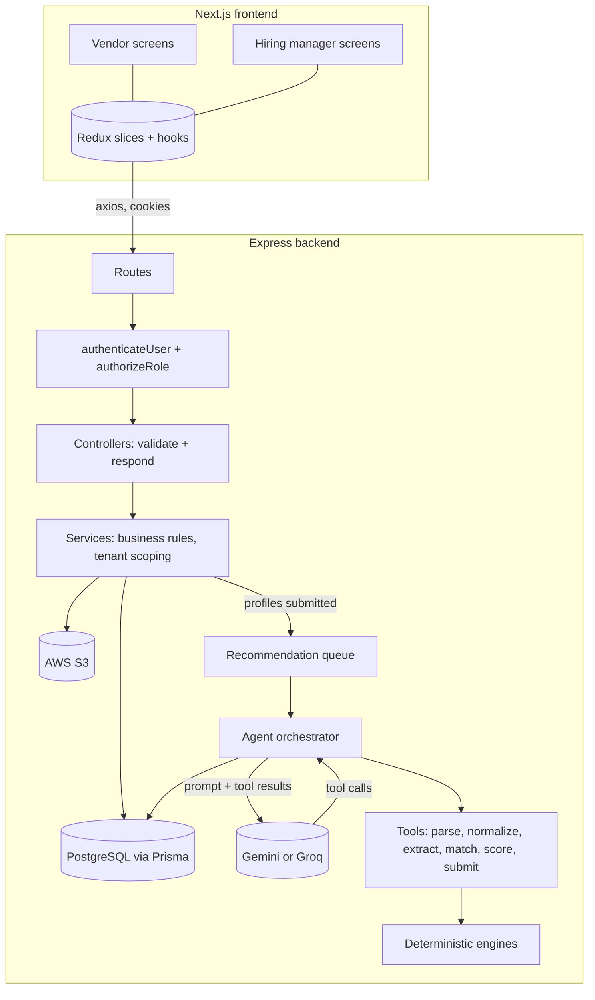

# HireLens

**Contract hiring with an AI recommendation agent.**

A multi-tenant **IT Vendor ↔ Hiring Manager** contract hiring module, built on the
Zelosify starter monorepo for the Zelosify technical assignment:

- **IT vendors** browse their tenant's open contract openings and submit candidate resumes (PDF / PPTX).
- An **LLM tool-calling agent** screens each submitted resume against the opening, asynchronously.
- **Hiring managers** see ranked candidates with an explained recommendation, then shortlist or reject.

The AI never decides the outcome: the LLM orchestrates tools and writes the explanation,
while the **score and decision come from deterministic engines** that the model cannot override.

| | |
|---|---|
| Backend | Express + TypeScript (ESM), Prisma 6, PostgreSQL, Keycloak (RS256 JWT), AWS S3 |
| Frontend | Next.js 15, React 19, Redux Toolkit, Tailwind |
| AI | Gemini (default) or Groq, via a provider-neutral tool-calling interface |
| Tests | Vitest: 185 tests (unit, HTTP integration, 100-profile performance) |

---

## Contents

1. [Quick start](#1-quick-start)
2. [Architecture](#2-architecture)
3. [API reference](#3-api-reference)
4. [AI recommendation agent](#4-ai-recommendation-agent)
5. [LLM providers, latency and the free-tier bottleneck](#5-llm-providers-latency-and-the-free-tier-bottleneck)
6. [Security](#6-security)
7. [Testing](#7-testing)
8. [Design decisions and known limitations](#8-design-decisions-and-known-limitations)

---

## 1. Quick start

Prerequisites: Node 22, Docker Desktop, a Gemini API key (free tier works).

```bash
# 1. Infrastructure (Postgres 17 + Keycloak)
cd Zelosify-Backend/Server
docker compose up -d

# 2. Backend
cp -n .env.example .env         # fresh clone only (-n never overwrites an existing .env); then fill in values
npm install
npm run prisma:generate
npm run prisma:migrate          # applies the Opening / hiringProfile / RecommendationRun models
npm run dev                     # http://localhost:5001

# 3. Demo data (tenant "Bruce Wayne Corp")
npm run seed:openings           # first run creates the tenant and prints its tenantId
#    → sign up a HIRING_MANAGER and an IT_VENDOR with that ID as "Organization ID"
#      (UI: http://localhost:5173/register, or POST /api/v1/auth/register)
npm run seed:openings           # second run creates the openings, assigned to the tenant's managers

# 4. Frontend
cd ../../Zelosify-Frontend
cp -n .env.example .env         # fresh clone only
npm install
npm run dev                     # http://localhost:5173
```

Keycloak realm, client and roles are set up as described in the original setup guide.
Users sign up at **`/register`**: choose *IT Vendor* or *Hiring Manager*, enter the Organization ID,
then scan the QR code with an authenticator app (Google Authenticator, Microsoft Authenticator, Authy).
Every sign-in asks for the 6-digit code. In development the
registration endpoint accepts every role. See [registration policy](#62-fixes-applied-to-the-starter-code)
for production behaviour.

| Role | Lands on | Can do |
|---|---|---|
| `IT_VENDOR` | `/vendor/openings` | browse openings, upload/delete own profiles, preview own resumes |
| `HIRING_MANAGER` | `/hiring-manager/openings` | see own openings, ranked profiles + AI recommendation, shortlist/reject, re-run AI |

> **API prefix:** the task brief writes endpoints as `/api/...`. This codebase versions all
> routes under **`/api/v1/...`** (as the starter code already did for auth), so
> `/api/hiring-manager/profiles/:id/shortlist` is served at `/api/v1/hiring-manager/profiles/:id/shortlist`.

---

## 2. Architecture



<details>
<summary>Text version (if the diagram does not render)</summary>

```
 Next.js frontend:  Vendor screens / Hiring manager screens  →  Redux slices + hooks
                                      │  axios (cookies)
                                      ▼
 Express backend:   Routes → authenticateUser + authorizeRole → Controllers → Services
                                                                               │
                         ┌─────────────────────┬────────────────────────────┤
                         ▼                     ▼                            ▼
                 PostgreSQL (Prisma)        AWS S3          Recommendation queue
                         ▲                                                  │
                         │                                                  ▼
                         └──────────────────────────────────  Agent orchestrator ⇄ Gemini / Groq
                                                                            │  (tool calls)
                                                                            ▼
                                       Tools: parse · normalize · extract · match · score · submit
                                                                            │
                                                                            ▼
                                                                Deterministic engines
```

</details>

**Layering** (task requirement "controllers must not contain business logic"):
`routes → controllers (validation + HTTP mapping) → services (rules, Prisma, S3) → engines`.
Services throw `HttpError`; a shared `sendError` maps them, so internal errors never leak to clients.

**Key flows**

- **Upload** (vendor): `presign` returns encrypted, short-lived upload tokens bound to *user + tenant + opening*.
  `upload` (multipart) verifies each token, checks the real file signature (`%PDF-` / ZIP header),
  pushes to S3 at `<tenantId>/<openingId>/<timestamp>_<filename>`, then writes all rows in **one Prisma transaction**
  (re-checking inside it that the opening is still `OPEN`). The API returns immediately.
- **Recommend** (async): a `profiles submitted` event enqueues the new profiles. The in-process queue runs
  them with bounded concurrency (`RECOMMENDATION_CONCURRENCY`, default 2) and de-duplicates. On startup, any
  `SUBMITTED` profile without a current recommendation is re-queued, so a restart never loses work.
- **Review** (manager): shortlist/reject use a guarded `updateMany … where status = SUBMITTED`, so concurrent
  clicks are safe (exactly one wins). Repeating the same action is idempotent. The opposite action returns `409`.

**Data model additions** (`prisma/schema.prisma`): `Opening`, `hiringProfile` (with the task's AI fields:
score, confidence, reason, latency, version, `recommendedAt`, soft delete), and `RecommendationRun`, one row per
`(profileId, agentVersion)` holding status, timings, token usage, tool trace, intermediate results and injection signals.

**Frontend**: one Redux slice + hook per persona (the repo's `FRONTEND_REDUX_STANDARDS_GUIDE`), skeleton loaders,
error boundaries, list virtualization above 50 rows, 3-second polling while recommendations are processing,
role-guarded routes in `middleware.js`, light/dark theme.

---

## 3. API reference

All routes require a Keycloak access token (cookie or `Authorization: Bearer`) **and** the role shown.
Resources outside the caller's tenant (or, for managers, not their own opening) return **404**, never 403,
so the API does not reveal that they exist.

### IT vendor: `/api/v1/vendor` (`IT_VENDOR`)

| Method | Path | Purpose |
|---|---|---|
| GET | `/openings?page&limit` | Open openings in the caller's tenant (paginated, max 50) |
| GET | `/openings/:id` | Opening detail + the caller's own submitted profiles |
| POST | `/openings/:id/profiles/presign` | `{ filenames[] }` → encrypted upload tokens (10 min) |
| POST | `/openings/:id/profiles/upload` | multipart `files[]` + `uploadTokens` (JSON array, same order). ≤10 files, ≤10 MB each, PDF/PPTX |
| DELETE | `/profiles/:profileId` | Soft delete (only while `SUBMITTED`) |
| GET | `/profiles/:profileId/preview` | Streams the resume through the backend (S3 is never exposed) |

### Hiring manager: `/api/v1/hiring-manager` (`HIRING_MANAGER`)

| Method | Path | Purpose |
|---|---|---|
| GET | `/openings` | Own openings with profile and "awaiting decision" counts |
| GET | `/openings/:id` | Opening detail incl. parsed required skills |
| GET | `/openings/:id/profiles?status&recommendation&page&limit` | Ranked profiles (score desc, pending last) with recommendation, score, confidence, explanation, latency, breakdown, matched/missing skills + badge summary |
| POST | `/profiles/:id/shortlist` | Shortlist (idempotent; `409` if already rejected) |
| POST | `/profiles/:id/reject` | Reject (idempotent; `409` if already shortlisted) |
| GET | `/profiles/:id/preview` | Stream resume |
| GET | `/profiles/:id/recommendation` | Lightweight status for polling |
| POST | `/profiles/:id/recommendation/rerun` | Queue a fresh run (`202`; de-duplicated) |

---

## 4. AI recommendation agent

### 4.1 Orchestration (not "one LLM call mapped to the DB")

```
runRecommendation(profileId)
  load profile + opening → build trusted requirements DTO (the LLM never sees DB models)
  prefetch resume from S3 + extract + proofread + sanitize   ← overlaps the first LLM call
  orchestrator loop (max 6 turns, 3 retries, 20 s deadline):
      LLM (tool-calling, forced) → validate args (JSON Schema) → run tool → return result → …
  validate all intermediate outputs → decision policy → persist in ONE transaction
```

| Tool | Kind | What it does |
|---|---|---|
| `parse_resume` | I/O | Returns sanitized visible text wrapped in `<untrusted_resume>` tags |
| `normalize_skills` | deterministic | Canonical skill names (`ReactJS` → `React`, `k8s` → `Kubernetes`) |
| `extract_features` | LLM-extracted, validated | Records experience/skills/location. **Drops skills not present in the resume text** (anti-hallucination) |
| `match_profile` | deterministic engine | Skill, experience and location match scores |
| `score_profile` | deterministic engine | Final weighted score |
| `submit_recommendation` | terminal | Model's explanation + self-assessed confidence + injection flag |

Tools enforce ordering (you cannot score before matching). Unknown tools, invalid arguments and
prose replies are reported back to the model to correct, and counted as retries.

### 4.2 Scoring (deterministic)

```
FinalScore = 0.5 · skillMatch + 0.3 · experienceMatch + 0.2 · locationMatch

skillMatch       = |required ∩ candidate| / |required|        (after normalization)
experienceMatch  = 0 below min · 1 within range · 0.8 above max
locationMatch    = 1 remote · 1 same city (aliases: Bengaluru=Bangalore …) · 0.5 onsite mismatch

≥ 0.75 RECOMMENDED · ≥ 0.50 BORDERLINE · < 0.50 NOT_RECOMMENDED
```

If the model's submitted score or verdict disagrees with the engines, the engines win and the
mismatch is logged (`llmScoreMismatch`).

**Confidence** = the model's confidence × data completeness, reduced for retries and ungrounded
skills, and **capped at 0.5 when manipulation is suspected**.

### 4.3 Idempotency, transactions, observability

- One `RecommendationRun` per `(profileId, version="agent-v1.0")`. Completed profiles are skipped
  unless re-run is forced. A re-run updates the same row (`attempt` + 1).
- Profile fields and the run row are written in a single `prisma.$transaction`, so there are no partial results.
- Structured JSON logs per step (`recommendation.started / llm.call / parsed / matched / completed / failed`)
  with tenant, opening, profile, model, turn, latency and token counts.
- Persisted per run: total latency, parsing / matching / LLM time, LLM calls, prompt/completion tokens,
  tool trace, parsed resume, feature vector, score breakdown, decision, injection signals, retries, error.

---

## 5. LLM providers, latency and the free-tier bottleneck

**Gemini is the default provider** (`LLM_PROVIDER=gemini`, model `gemini-3.5-flash-lite`).
**Groq is a documented, drop-in alternative** (`LLM_PROVIDER=groq`), with a model fallback chain
(`qwen/qwen3.8-27b → openai/gpt-oss-120b → openai/gpt-oss-20b`), because each Groq model has its own
free-tier budget. Both implement the same `LlmClient` interface, so the orchestrator is unchanged.

### Measured latency

| Setup | Per-profile latency | Notes |
|---|---|---|
| **Pipeline only** (simulated LLM, 150 ms/call, 100 profiles) | **P50 455 ms · P95 457 ms · max 486 ms** | `npm run test:perf`. Parsing ≈ 3 ms, matching < 1 ms, upload API ≤ 80 ms |
| Gemini free tier (real runs) | 4.4 s – 13.2 s (n = 2) | ~3 LLM turns, ~4.4k tokens |
| Groq free tier (real runs) | 3.2 s – 6.5 s, P50 3.6 s (n = 3) | ~4.7 LLM turns, ~7.8k tokens |

**The task's targets (≤ 1500 ms per profile, P95 < 2000 ms) are met by everything we control, but not with
free-tier LLMs.** Almost all of the time is model latency plus rate-limit back-off on shared free-tier
capacity. Each run needs at least 3 sequential model turns, because the agent architecture requires real tool use.

What we do about it:

- **Async by design:** uploads return immediately (≤ 80 ms in the perf test). Recommendations run in a
  bounded background queue, and the UI shows a processing state and polls, so **no API blocks > 2 s and the UI never freezes**.
- **Latency is stored per profile** (`recommendationLatencyMs`) and per run, with an `slaBreached` flag in logs.
- **Short prompts, forced tool calls, temperature 0, batched tool calls** (turn 2 runs four tools at once),
  resume prefetch overlapping the first LLM call.

To meet the SLA in production: a paid tier / provisioned throughput, a low-latency model in the nearest
region, and raising `RECOMMENDATION_CONCURRENCY` once rate limits allow.

---

## 6. Security

### 6.1 Built into the hiring module

**Access control and tenant isolation**
- API-level RBAC on every route: verified RS256 JWT + realm role.
- The tenant always comes from the **server-side user record**, never from request input. Every query is
  scoped by tenant, and for managers also by `hiringManagerId`. Cross-tenant access returns `404`. Covered by unit
  tests (query shapes) and HTTP integration tests (two tenants, two managers, two vendors).

**Uploads**
- Encrypted (AES-256-GCM) upload tokens bound to user, tenant, opening and expiry; replay and cross-user reuse rejected.
- Real file-signature checks (MIME headers are not trusted), size and count limits, sanitized filenames.
- Files are only reachable by streaming through the backend after an ownership check.

**Prompt-injection defence in depth**

| Layer | What it does |
|---|---|
| 1. Architecture | The LLM cannot set the score or decision. Deterministic engines + decision policy do, and they ignore the model's numbers |
| 2. Hidden-text proofreader | Text a human cannot see is removed before the AI sees the resume: white-on-white / low contrast (compared with what is drawn *behind* it), < 4 pt fonts, invisible render mode, off-page, covered by a shape or image. PDF via the pdf.js operator list; PPTX via slide XML incl. layout → master → theme backgrounds. **No OCR needed** |
| 3. Sanitization | Unicode normalization; strips invisible/control/bidi characters; neutralizes fake `</untrusted_resume>` / `<system>` tags; length cap |
| 4. Isolation | Resume text is delivered only as a tool result inside `<untrusted_resume>` tags; the system prompt declares it data, never instructions |
| 5. Detection | Patterns by category (instruction override, role hijack, score manipulation, prompt exfiltration, tool abuse), matched on leetspeak-folded and letters-only copies (catches `i g n o r e`, `1gn0r3`) |
| 6. Grounding + validation | Every tool argument is JSON-Schema validated; extracted skills must appear in the **visible** resume text |
| 7. Response | Signals stored on the run; confidence capped at 50%; warning banner in the hiring-manager UI |

**Red-team results** (control resume + 13 attack or legitimate-design variants against the same opening):
every attack keeps the control's score (0.60). The 8 hidden-text attacks are all removed and reported. The two
legitimate designs (white text on a dark banner / dark PPTX header) are **not** flagged. Writing the tests
also uncovered and fixed two real bugs: numeric "score of 1.0" phrases were never detected (leet folding turned
digits into letters), and the bundled pdf.js misread small resumes (< 4 KB) because Node's shared buffer pool
gave it the wrong bytes.

### 6.2 Fixes applied to the starter code

| Issue | Fix |
|---|---|
| **Privilege escalation**: public `POST /auth/register` accepted any `role` from the body (e.g. `ADMIN`) | `registrationPolicy.ts`: `SELF_REGISTRATION_ROLES` (default none) are open. Every other role needs an admin-issued `X-Registration-Key` (constant-time compare). With no key configured, **production refuses** and development stays open so the setup guide still works |
| **Brute force**: unlimited TOTP / password guesses | `attemptLimiter.ts` (no extra packages): 5 failures per account (TOTP) or account+IP (password), then a 15-min lock, plus 20 per IP. In-flight requests count, so parallel bursts cannot bypass it. `429` + `Retry-After`. Wrong registration keys are limited too |
| **Operator injection**: auth endpoints passed JSON body values straight into Prisma `where` clauses, so `{"usernameOrEmail": {"contains": ""}}` matched a real user (email enumeration, bypassed the per-account limit) | `requireStringFields` middleware: auth fields must be plain strings (≤ 512 chars), otherwise `400`. (No raw SQL exists anywhere; Prisma parameterizes every value, so classic SQL injection is not possible) |
| **Unverified route guard**: Next.js middleware only checked that token cookies *existed* and read the role unverified, so hand-made cookies opened any role's page frame (the API still refused them) | The middleware verifies the access token's **RS256 signature and expiry** with Web Crypto (no packages), using the realm public key from `GET /auth/public-key` (or `KEYCLOAK_RS256_SIG`). Rejects `alg: none` and edited tokens; fails closed |
| **No sign-up validation / half-created accounts**: registration accepted any text (phone `abc`, name `123`, weak passwords, padded values); a Keycloak "user exists" became a 500; a failed role assignment was only logged (user created without a role); a DB failure left an orphan Keycloak user | Field rules enforced on the backend (`registrationValidation.ts`, per-field `400`, values trimmed) and mirrored in the form for inline messages; Keycloak `409` → "already registered"; role assignment is mandatory and any failure after the Keycloak user is created deletes it again |
| **No session refresh**: the refresh token was stored but never used, so users were sent to sign-in when the 4-hour access cookie ended | `POST /auth/refresh` (httpOnly cookie → new token pair, tokens never in the body). The route guard sends expired sessions to `/session/restore`, which renews silently and returns to the requested page (open-redirect safe, loop-guarded). The API client retries a `401` once after a shared refresh. If the Keycloak session has ended: sign-in with a "session expired" notice |

Sessions live in `httpOnly`, `sameSite=strict` cookies (unreadable by page scripts), so a signed-in user stays signed in
across reloads and browser restarts until Keycloak ends the session (realm defaults: 30 min idle, 10 h maximum;
adjust in *Realm settings → Sessions* for longer "remember me" sessions).

### 6.3 Known issues in the starter code (not changed)

Found while auditing the whole system. They are outside the hiring module's scope; listed by when they must be addressed.

**Required before go-live**

| Severity | Issue | Recommended fix |
|---|---|---|
| High | **Real AWS access keys are published in the setup guide** | Rotate the keys now; use per-environment IAM users/roles with least privilege |
| High | TOTP secrets, access and refresh tokens stored in plain text (`User` table) | Encrypt with the existing `encrypt()` helper (migrate existing rows); avoid storing tokens at all |
| High | 2FA bypass for usernames matching `user\d+` (seeded users) | Disable outside development |
| Medium | Global error handler returns `err.message`; debug logger prints full headers and bodies (tokens) | Generic 500 in production; remove or redact header and body logging |
| Medium | `SESSION_SECRET` falls back to `"my-secret"` | Refuse to start in production without it |
| Low | Login answers "User not found" vs "Invalid credentials" (username enumeration) | Same message for both |

**Architecture: when scaling beyond one instance**

| Topic | Today | At scale |
|---|---|---|
| User cache, attempt limiter, recommendation queue | In process memory | Redis (sessions, limiter, cache) and a durable queue (e.g. BullMQ / SQS) |
| Keycloak / DB outages | Startup exits on failure; no circuit breaker | Startup retries with back-off; circuit breakers on Keycloak calls; graceful SIGTERM shutdown |
| Rate limiting | Auth endpoints only | API gateway / load balancer limits for all routes |
| Uploads | Through the backend (≤ 10 × 10 MB per request) | Direct-to-S3 presigned uploads + async scanning |
| Transport | HTTP locally | TLS everywhere (terminated at the load balancer), HSTS, `secure` cookies (already enabled when `NODE_ENV=production`) |

---

## 7. Testing

```bash
cd Zelosify-Backend/Server
npm run test:run          # everything (Docker Postgres must be running)
npm run test:unit
npm run test:integration
npm run test:perf
```

Tests use the real routers, auth middlewares, services, Prisma (against the Docker database, with
isolated tenants created and removed per run), PDF/PPTX extraction and the agent orchestrator. Only external
systems are replaced: **Keycloak** by a per-run RSA key pair (real JWT verification), **S3** by an in-memory store,
and the **LLM** by a scripted fake that speaks the same tool-calling protocol (and can be told to misbehave).

| Area | Highlights |
|---|---|
| Scoring | experience boundaries (2.99 / 3 / 6 / 6.01 years), skill overlap and aliases, formula table, thresholds at 0.75 / 0.5, clamping, determinism, location aliases |
| Access | 401 (missing / forged / expired token), 403 wrong role, tenant-scoped queries, tenant from server-side user only |
| Full flow | Upload → Submit → Recommend → Shortlist over HTTP; S3 key layout; persisted latency, tokens, tool trace |
| Isolation | other tenant's vendor/manager, other manager in the same tenant, other vendor's profile: all `404`, nothing changes |
| Concurrency | simultaneous shortlist + reject: exactly one wins; queue concurrency bound and de-duplication |
| AI safety | lying model + injected resume keeps the deterministic decision; hidden text never reaches the AI; malformed output retried; LLM failure → re-run |
| Security fixes | 50 parallel TOTP guesses get ≤ 5 tries; correct code refused while locked; privileged registration refused in production |
| Performance | 100 profiles: P95 < 2000 ms, every profile ≤ 1500 ms, list API < 2 s |

---

## 8. Design decisions and known limitations

- **In-process queue** instead of Redis/BullMQ: no extra infrastructure for the assessment; restart-safe via
  the recovery scan. Swap for a durable queue when running several instances.
- **No skills column on `Opening`**: required skills are parsed from the description's `Required skills:` line,
  to avoid changing the given schema.
- **LLM via REST (axios)**, no provider SDKs: no new dependencies; Gemini and Groq share one interface.
- **Non-English injection text** is not pattern-detected (the score is still unaffected). White text on a gradient or
  picture background, or text hidden behind a picture's white area, cannot be judged without OCR and is treated as visible.
- **Sign-up and SSO in the starter UI:** the original sign-up form could not work: it sent `companyName`
  instead of the required `tenantId`, offered roles that do not exist, and redirected to a `/setup-totp` page
  and `/auth/verify-initial-totp` endpoint that were never implemented. It was rebuilt (Organization ID, the two
  personas, an on-page 2FA enrolment step). The Google/Microsoft buttons call backend routes that do not exist
  and need OAuth apps registered in Keycloak, so they are hidden behind `NEXT_PUBLIC_ENABLE_SSO` (default off).
- **Landing page:** the starter's landing page was an empty page with a navbar; it now explains the product
  (hero, how it works, key features) in light and dark mode.
- **Empty placeholder files** (`helper1.ts`, `model1.ts`, `dummySlice1.js`, the MongoDB stubs, the unfinished
  resource-request attachment controllers, etc.) come empty from the starter's Initial commit. Nothing imports them,
  so they were left unchanged; the hiring module lives in its own files following the same folder structure.
- **Responsive layout:** the starter dashboard layout shows a "use a larger screen" overlay below 1024 px. The new
  screens are responsive, but the overlay belongs to the existing layout and was left unchanged.
